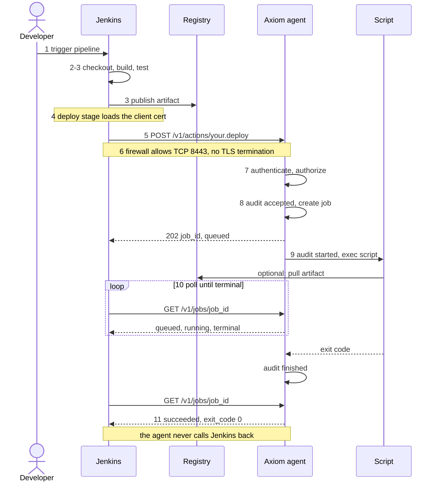
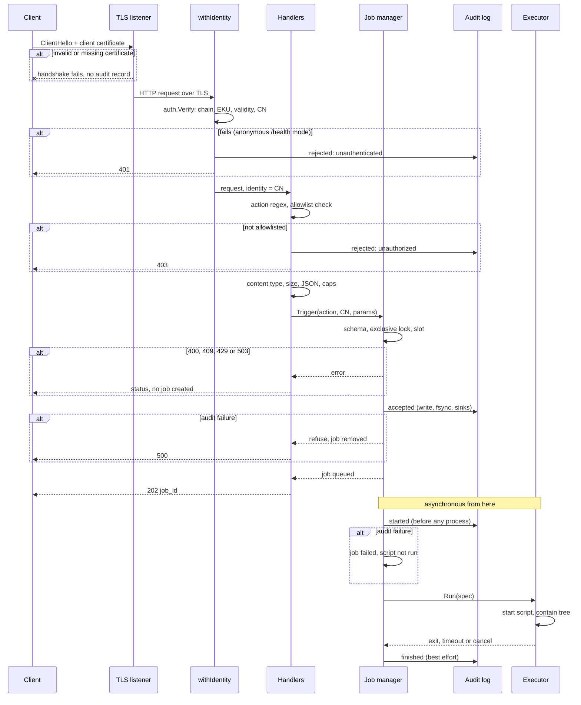
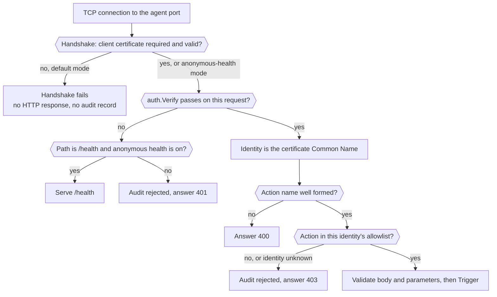
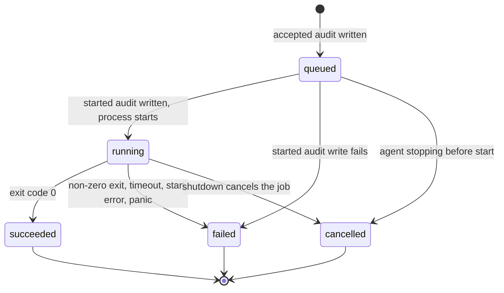
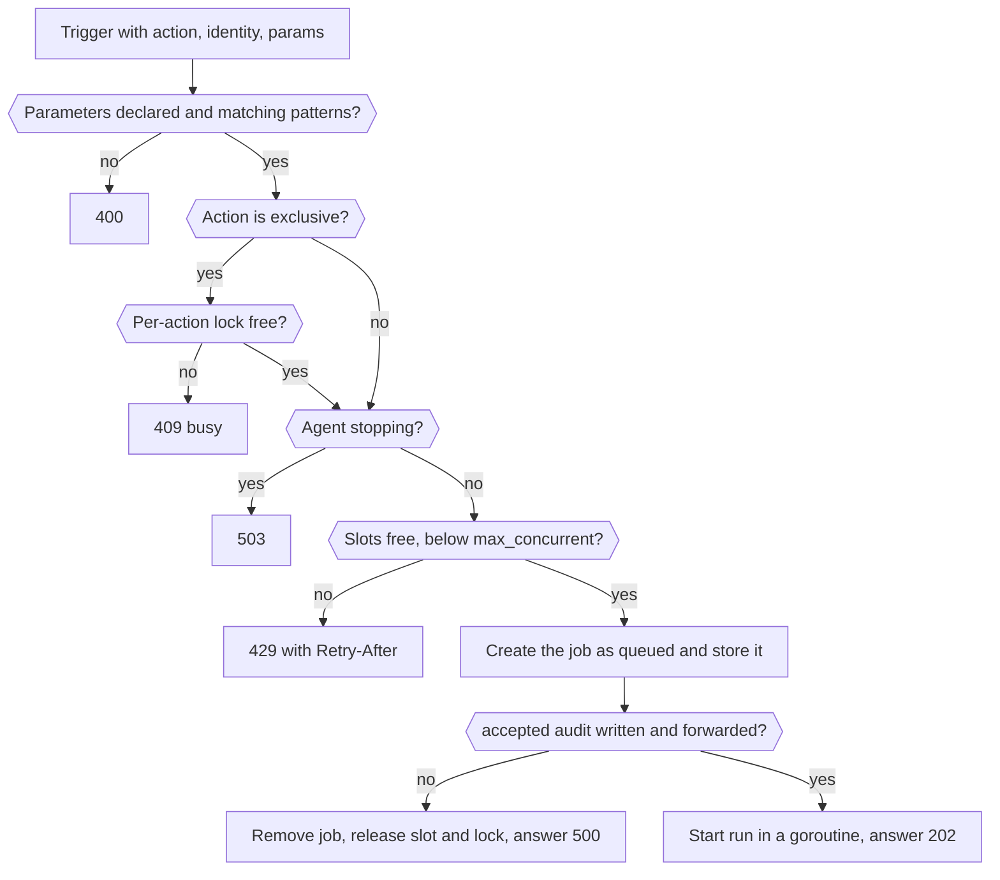

<div class="ax-hero" markdown>

<p class="ax-kicker">Architecture and engineering presentation</p>

# Axiom in a banking infrastructure { .ax-title }

<p class="ax-lede">Axiom lets a trusted CI system trigger predefined actions on a server over mutual TLS, without giving it SSH. This presentation places the agent in an illustrative banking estate, then opens it up and follows one request through the Go implementation.</p>

<div class="ax-facts">
<div><p class="k">Release described</p><p class="v">v2.0.2, source at 601357c</p></div>
<div><p class="k">Platforms</p><p class="v">Linux (systemd), Windows (service)</p></div>
<div><p class="k">API surface</p><p class="v">Four HTTP routes</p></div>
<div><p class="k">Outbound connections</p><p class="v">None made by Axiom</p></div>
<div><p class="k">Evidence</p><p class="v">Go source, tests, packaging</p></div>
</div>

<ol class="ax-index">
<li><a href="#introduction">Introduction</a><span>What Axiom is, what it is not, how to read this page</span></li>
<li><a href="#environment">The banking infrastructure environment</a><span>CI/CD zone, firewall, bank zone and every traffic class</span></li>
<li><a href="#topology">Axiom deployment topology</a><span>One agent per host, and what the network must allow</span></li>
<li><a href="#scenario">End-to-end deployment scenario</a><span>From a developer commit to a polled result</span></li>
<li><a href="#internals">Internal architecture</a><span>Packages, responsibilities and source locations</span></li>
<li><a href="#lifecycle">Request lifecycle</a><span>The audited path, including every rejection</span></li>
<li><a href="#authn">Authentication and authorization</a><span>Certificate identity and the default-deny allowlist</span></li>
<li><a href="#jobs">Job execution</a><span>State machine, admission control, output and ownership</span></li>
<li><a href="#audit">Audit architecture</a><span>JSONL, fsync, redaction, sinks and failure behaviour</span></li>
<li><a href="#platforms">Linux and Windows implementations</a><span>Ten concerns, side by side</span></li>
<li><a href="#boundaries">Security boundaries</a><span>What enforces each boundary, and what remains</span></li>
<li><a href="#limits">Failure handling and limitations</a><span>Stated plainly, with source references</span></li>
</ol>

</div>

## 1. Introduction {#introduction}

Axiom is one static Go binary that runs on a managed host and exposes four routes. A caller with a certificate from the bank's own CA can ask it to run an action that the host's operator declared in advance. It cannot ask for anything else: there is no field, route or parameter through which a request names an executable, an argument or a script path.

Everything that follows separates two things that are easy to blur in an architecture diagram.

| Axiom, implemented and source-verified | The bank, illustrative or customer-owned |
|---|---|
| mTLS listener, per-request certificate verification, Common Name identity | Jenkins, pipelines, the credential store |
| Default-deny identity-to-action allowlist, owner-only job access | Firewalls, segmentation, WAF and load balancer |
| Fixed, validated execution: no shell, no arbitrary path | Web, application and database servers, and the application on them |
| Timeouts, output caps, job limits, process-tree containment | The action scripts: deploys, restarts, registry pulls |
| JSONL audit with fsync, Linux syslog sink | SIEM or collector, retention, log shipping on Windows |
| Startup integrity checks on config, certificates and scripts | PKI: issuing, rotating and revoking certificates |

!!! note "The topology is an example"
    The banking layout in sections 2 and 3 is an illustrative deployment pattern. Axiom has no concept of tiers, banks, a fleet or a central controller. Each agent knows only its own configuration.

Sections 2 to 4 are about deployment. Sections 5 to 12 are about the implementation, and every behavioural claim names the file or function that backs it.

## 2. The banking infrastructure environment {#environment}

Three areas matter. An engineering zone runs Jenkins and the build. A perimeter firewall separates it from the bank network. Inside the bank zone, customer traffic flows through web, application and database tiers, and a separate path carries Axiom's control traffic to a small agent on each managed host.

<figure class="ax-fig" id="fig-topology" markdown>
<div class="ax-scroll">
--8<-- "topology.svg"
</div>
<figcaption>Figure 1. Illustrative banking deployment. Blue is Axiom's control plane, teal is local execution, grey is customer application traffic, amber is audit forwarding. Numbered badges follow the scenario in section 4. Port 8443 is the value in the shipped example configuration; the operator sets it.</figcaption>
</figure>

Reading the figure:

Control plane
:   Solid blue. The Jenkins build executor opens a TCP connection to port 8443 on a target host and speaks HTTPS with mutual TLS. Jenkins always initiates; the agent never calls back.

Local execution
:   Dotted teal. The agent runs a predefined script on its own host. What the script does, such as a deployment, a service restart or an artifact pull, is the bank's logic, not Axiom's.

Application traffic
:   Grey, in its own lane on the right. Customers reach the web tier through the WAF or load balancer, the web tier calls the application tier, and the application tier talks to the database. Axiom does not proxy, inspect or manage any of it.

Optional artifact pull
:   Dashed grey. If a script pulls an image or artifact from the registry, that is the script's own network path and the bank's own firewall rule.

Audit and certificates
:   Dashed amber is audit forwarding, available on Linux through journald or syslog. Dotted grey is certificate issuance by the bank's PKI, which sits entirely outside Axiom.

!!! warning "No TLS-terminating device in the Axiom path"
    The agent takes the caller's identity from the client certificate presented on the TCP connection it terminates (`internal/api/middleware.go`, `withIdentity`). There is no forwarded-header support. A reverse proxy or a TLS-terminating WAF between Jenkins and the agent would remove the certificate and break authentication. Direct connections or Layer 4 TCP passthrough are the only supported shapes.

The database tier shows an agent drawn with a dashed outline. It is optional: it exists only if the bank needs Jenkins to trigger an action that must run on the database host itself. Application-to-database SQL has no relationship to it.

## 3. Axiom deployment topology {#topology}

Each managed host runs its own agent with its own configuration, its own server certificate and its own allowlist. Agents do not know about one another, and nothing aggregates them. A pipeline that deploys to four hosts makes four independent requests.

<figure class="ax-fig" id="fig-host" markdown>
<div class="ax-scroll">
--8<-- "host.svg"
</div>
<figcaption>Figure 2. One managed host. The service account reads its binary, configuration, certificates and scripts but cannot change them; it can write only the audit log directory and its state and temp locations.</figcaption>
</figure>

### What the network must allow

| Path | Direction | Port | Notes |
|---|---|---|---|
| CI executor to agent | Inbound to the host | The configured `agent.listen.port` (8443 in the shipped examples) | Mutual TLS, no termination in between |
| Axiom to anything else | None | n/a | The agent makes no outbound connections |
| Script to registry or services | Outbound, defined by the script | Customer defined | The systemd unit permits `AF_INET`, `AF_INET6`, `AF_UNIX`, `AF_NETLINK` |
| Host to log collector | Through the local syslog daemon | Customer defined | Linux only |

### Provisioning, as the installers actually behave

- Neither installer generates certificates, overwrites an existing `config.yaml` or starts the service. The operator places certificates and configuration, then starts it.
- Linux creates a dedicated `axiom` user and a root-owned layout under `/etc/axiom` and `/opt/axiom/actions`; only `/var/log/axiom` and `/var/lib/axiom` belong to the service account.
- Windows registers the service as `NT SERVICE\axiom` and applies inheritance-protected NTFS ACLs, with modify rights only on `logs\`.
- The only example action Axiom installs is `hello.world`, a script that prints a greeting and exits 0.

## 4. End-to-end deployment scenario {#scenario}

<ol class="ax-steps">
<li>A developer triggers the Jenkins pipeline.</li>
<li>Jenkins checks out the application source.</li>
<li>Jenkins builds, tests and publishes the artifact to the registry.</li>
<li>The deployment stage invokes a predefined Axiom action.</li>
<li>Jenkins sends an HTTPS request carrying its client certificate.</li>
<li>The request crosses the firewall and reaches the target host's agent.</li>
<li>Axiom authenticates the certificate, authorizes the action and validates the parameters.</li>
<li>Axiom writes the accepted audit record and creates an asynchronous job.</li>
<li>Axiom writes the started audit record and runs the preconfigured local script.</li>
<li>Jenkins polls the job with the same certificate.</li>
<li>Jenkins receives the terminal status and marks the build.</li>
</ol>

<figure class="ax-fig" markdown>

<figcaption>Figure 3. The deployment scenario. Responses travel on the connection Jenkins opened. Only Jenkins initiates.</figcaption>
</figure>

### The API in detail

=== "Trigger"

    ```http
    POST /v1/actions/your.deploy HTTP/1.1
    Host: app-01.internal.example:8443
    Content-Type: application/json

    {"parameters": {"image_tag": "build-1842"}}
    ```

    ```http
    HTTP/1.1 202 Accepted
    Content-Type: application/json

    {"job_id":"01J8ZQ4M6T3N7V2K9R5W0XDHBE","status":"queued"}
    ```

=== "Poll"

    ```http
    GET /v1/jobs/01J8ZQ4M6T3N7V2K9R5W0XDHBE HTTP/1.1
    ```

    ```json
    {
      "job_id": "01J8ZQ4M6T3N7V2K9R5W0XDHBE",
      "action": "your.deploy",
      "status": "succeeded",
      "exit_code": 0,
      "started_at": "2026-11-20T09:14:03.412Z",
      "finished_at": "2026-11-20T09:14:41.907Z",
      "duration_ms": 38495
    }
    ```

=== "Logs"

    ```http
    GET /v1/jobs/01J8ZQ4M6T3N7V2K9R5W0XDHBE/logs HTTP/1.1
    ```

    ```json
    {
      "stdout": "deploying image tag: build-1842\n",
      "stderr": "",
      "stdout_truncated": false,
      "stderr_truncated": false
    }
    ```

=== "Server side"

    The host's operator declared the action, its parameter schema and who may run it. A request can select only what exists here.

    ```yaml
    actions:
      your.deploy:
        command: /opt/axiom/actions/deploy.sh
        timeout: 10m
        concurrency: exclusive
        parameters:
          image_tag:
            type: string
            pattern: '^[a-zA-Z0-9._-]{1,128}$'
            required: true

    authorization:
      identities:
        ci-jenkins:            # must equal the client certificate's Common Name
          actions:
            - your.deploy
    ```

    The script receives the validated value as `AXIOM_PARAM_IMAGE_TAG` in its environment. It is never part of a command line.

=== "Status codes"

    | Code | Meaning | Source |
    |---|---|---|
    | 202 | Job accepted, returned before the script starts | `handleTriggerAction` |
    | 400 | Bad action name, body, parameter name or value | `handlers.go`, `jobs.validateParameters` |
    | 401 | No verified certificate (anonymous `/health` mode only) | `withIdentity` |
    | 403 | Identity not allowlisted for this action, including names that do not exist | `handleTriggerAction` |
    | 404 | Job unknown, malformed, or owned by another identity | `ownedJob` |
    | 409 | Exclusive action already running | `jobs.ErrActionBusy` |
    | 415 | Content type is not JSON | `handleTriggerAction` |
    | 429 | Agent-wide job cap reached, with `Retry-After` | `jobs.ErrTooManyJobs` |
    | 503 | Agent is shutting down | `jobs.ErrShuttingDown` |

## 5. Internal architecture {#internals}

One lifecycle function, `serve`, builds and wires everything. The unix and Windows entrypoints differ only in how they obtain a context and a configuration. Platform behaviour lives in build-tagged files behind small seams, so the request path is shared code on both operating systems.

<figure class="ax-fig" id="fig-internal" markdown>
<div class="ax-scroll">
--8<-- "internal.svg"
</div>
<figcaption>Figure 4. Inside one agent. Blue boxes are the request path, amber is audit, teal is process execution. File paths are relative to the repository root.</figcaption>
</figure>

Implementation notes

- **Fail before listening.** `config.Load` validates the whole file, then checks ownership and permissions of the config, CA, certificate, key, every script and each ancestor directory. A problem aborts startup.
- **The request cannot name what runs.** `executor.Spec` carries a script path, an environment, a timeout and an output cap. There is no field for an executable, an argument or inline source.
- **Audit is part of admission.** The job manager holds the audit logger and will not create or start a job without writing its record.
- **State is small and local.** Runtime state is the in-memory job store, guarded by explicit locks taken in a consistent order, and the audit file.

## 6. Request lifecycle {#lifecycle}

<figure class="ax-fig" id="fig-lifecycle" markdown>

<figcaption>Figure 5. One request, with the rejection and failure paths. Audit records are written in the order accepted, started, finished, and the first two gate execution.</figcaption>
</figure>

!!! tip "Ordering that matters"
    `accepted` is written before the job is returned to the caller and before any goroutine runs it. `started` is written before `executor.Run` is called. If either write, or its hand-off to a sink, fails, the script does not run. `finished` is best effort because the outcome is already decided.

### Why Axiom never accepts a path or a command

1. **No input carries one.** The only variable in a trigger is the action name, used as a map key into configuration the operator wrote. Parameters are named, typed and matched against a regular expression, then passed as environment variables.
2. **No shell is involved.** On unix the script is executed directly. On Windows the argument vector is fixed and only the configured script path varies; `-Command` and `-EncodedCommand` never appear, and a test asserts it (`executor_windows_test.go`).
3. **The script is verified, not just named.** At startup each configured script must be an absolute, clean, non-symlink path, owned by root or Administrators, with no write access for the service account along its whole directory path.
4. **There is no such route.** `TestIntegration_NoArbitraryExecuteEndpoint` asserts an execute-shaped endpoint cannot succeed.

## 7. Authentication and authorization {#authn}

<figure class="ax-fig ax-fig-tight" id="fig-authn" markdown>

<figcaption>Figure 6. Authentication, then authorization. An unlisted identity, an unlisted action and a misspelt action all receive the same 403.</figcaption>
</figure>

| Property | Behaviour | Source |
|---|---|---|
| Trust root | Only the CAs in `security.mtls.ca_file`; every certificate there is a trust anchor | `auth.TLSConfig`, `auth.Verify` |
| TLS | Minimum 1.2; ECDHE with AEAD suites on 1.2; X25519 and P-256 | `auth.TLSConfig` |
| Client verification | Chain to the pool, `clientAuth` extended key usage, current time, non-empty CN | `auth.Verify` |
| Checked twice | At the handshake (default mode) and again on every request | `TLSConfig`, `withIdentity` |
| Identity | Leaf Common Name only; SANs are ignored | `auth.Identity` |
| Authorization | Exact-string membership in a per-identity list; default deny | `config.Identity.IsAllowed` |
| Job access | A job is visible only to the identity that triggered it | `ownedJob` |
| Revocation | None: no CRL or OCSP | `auth.Verify` |

!!! warning "Identity is only as strong as certificate issuance"
    Because identity is the Common Name, the bank's CA must never let a requester choose it. A stolen client certificate keeps working until it expires or its identity is removed from the configuration and the agent is restarted. Short-lived, per-pipeline certificates are the available mitigation.

## 8. Job execution {#jobs}

<figure class="ax-fig ax-fig-tight" id="fig-states" markdown>

<figcaption>Figure 7. Job states. A job is created in memory only after capacity is reserved, and leaves memory when history is trimmed or the agent restarts.</figcaption>
</figure>

<figure class="ax-fig ax-fig-tight" id="fig-admission" markdown>

<figcaption>Figure 8. Admission control. A rejected trigger creates no job and leaves no lock or slot held.</figcaption>
</figure>

| Control | Value | Source |
|---|---|---|
| Action timeout | 1 s to 24 h, per action | `config.MinActionTimeout`, `MaxActionTimeout` |
| Stop behaviour | Unix: SIGTERM to the group, 5 s grace, SIGKILL. Windows: immediate job termination | `executor.Run`, `TerminationGracePeriod` |
| Agent-wide job cap | `jobs.max_concurrent`, default 16 | `config.DefaultMaxConcurrentJobs` |
| Retained history | `jobs.max_history`, default 1000; the oldest finished job is evicted first | `Manager.recordJob` |
| Captured output | `output.max_bytes` per stream, default 2 MiB | `executor.cappedBuffer` |
| Request caps | 64 KiB body, 64 parameters, 4096 bytes per value | `handlers.go` |

Output and ownership
:   Stdout and stderr are captured into capped in-memory buffers, truncated beyond the limit without throttling the process, and returned only to the identity that triggered the job. Output is never written to the audit trail.

Memory, not storage
:   Job state is not persisted. A restart, a crash or a host reboot clears it, and a caller polling an old job id receives 404. The audit log is the durable record of what ran.

## 9. Audit architecture {#audit}

<figure class="ax-fig" id="fig-audit" markdown>
<div class="ax-scroll">
--8<-- "audit.svg"
</div>
<figcaption>Figure 9. From event to evidence. The local file is an operational copy; on Linux the central collector behind the syslog sink is the authoritative record.</figcaption>
</figure>

An accepted-through-finished sequence for one job, as it appears in the file (one JSON object per line):

```json
{"timestamp":"2026-11-20T09:14:03.398Z","agent":"example-app-01","event":"accepted","job_id":"01J8ZQ4M6T3N7V2K9R5W0XDHBE","identity":"ci-jenkins","action":"your.deploy","parameters":{"image_tag":"build-1842"}}
{"timestamp":"2026-11-20T09:14:03.412Z","agent":"example-app-01","event":"started","job_id":"01J8ZQ4M6T3N7V2K9R5W0XDHBE","identity":"ci-jenkins","action":"your.deploy"}
{"timestamp":"2026-11-20T09:14:41.907Z","agent":"example-app-01","event":"finished","job_id":"01J8ZQ4M6T3N7V2K9R5W0XDHBE","identity":"ci-jenkins","action":"your.deploy","result":"succeeded","duration_ms":38495}
```

What the audit trail guarantees, and what it does not

- Each write is flushed with `fsync` before the call returns, and any sink error is returned to the caller, which is what makes the accepted and started records fail closed.
- Redaction is by parameter name (names containing `token`, `secret`, `pass`, `key`, `cert` and similar). A secret carried in a parameter with an innocent name would be written verbatim.
- The local file is owned by the account that runs scripts, so that account can alter it. Tamper resistance comes from the collector, not the file.
- Failed TLS handshakes never reach this log. `net/http` writes them to its default logger on stderr, so failed-authentication monitoring needs the network layer.

## 10. Linux and Windows implementations {#platforms}

The external API, configuration schema, authentication and authorization are identical. What differs is how the host is protected and how a script is contained.

<figure class="ax-fig" id="fig-platforms" markdown>
<div class="ax-scroll">
--8<-- "platforms.svg"
</div>
<figcaption>Figure 10. Ten concerns on each platform. Red outlines mark the two places where Windows has a gap that Linux does not.</figcaption>
</figure>

## 11. Security boundaries {#boundaries}

| Boundary | Enforced by | Source | What remains |
|---|---|---|---|
| Network to listener | Mutual TLS, one trust root | `auth.TLSConfig` | No revocation check, no rate limiting |
| Identity to action | Default-deny allowlist keyed by CN | `Identity.IsAllowed`, `handleTriggerAction` | Changes need a restart; CN issuance is the CA's job |
| Request to job manager | Schema, size, regex and parameter validation | `handlers.go`, `config.Parameter` | A script can still mishandle a validated value |
| Job visibility | Owner-only status and logs | `ownedJob` | State is in memory only |
| Axiom to script | No shell, fixed invocation, constructed environment, timeout, output cap, containment | `executor`, `jobs.buildEnv` | Axiom does not constrain what a script does |
| Service account to its own files | Startup integrity checks, systemd or NTFS sandbox | `config/script_security_*`, `winsec`, `axiom.service` | Docker group access is root-equivalent; the Windows account holds `SeImpersonatePrivilege` |
| Axiom to audit | Fail-closed accepted and started, fsync | `audit.Logger.Write` | Local file alterable; finished record best effort; no Windows sink |
| Release to host | GPG-signed RPMs and checksums, SBOM, provenance | `release.yml`, `sign-release.sh` | Windows binaries are not Authenticode-signed |

## 12. Failure handling and limitations {#limits}

### How it fails

| Situation | Behaviour | Source |
|---|---|---|
| Bad configuration or insecure file | Refuses to start; under the Windows SCM it stops with exit code 13 | `config.Load`, `service_windows.go` |
| Audit write fails at accept | Job removed, 500, script never runs | `Manager.Trigger` |
| Audit write fails at start | Job marked failed, script never runs | `Manager.run` |
| Script exceeds its timeout | Tree terminated, job failed with the timeout reason | `executor.Run` |
| Panic in a job goroutine | Recovered, job failed, finished record written | `Manager.run` |
| Graceful stop | New triggers get 503, HTTP drains up to 30 s, running jobs are cancelled and recorded as interrupted | `serve`, `Manager.Shutdown` |
| Crash, SIGKILL or power loss | No finished record, job state lost; the child is killed by Pdeathsig or the Job Object | `executor` containment |
| Trigger response lost | No idempotency key: an exclusive action answers 409, a shared action may run twice | `docs/jenkins-integration.md` |
| Certificate or identity change | Takes effect only after a restart | `docs/certificates.md` |

### What Axiom does not do

<div class="ax-ledger">
<div><b>Check certificate revocation</b><span>A stolen client certificate keeps working until it expires or its identity is removed and the agent restarted.<em>internal/auth/auth.go, Verify</em></span></div>
<div><b>Rate limit</b><span>Connection, handshake and request rates are not bounded, and every audit record costs a synced write. Contain with network controls and systemd resource limits.<em>docs/THREAT-MODEL.md, resource limits</em></span></div>
<div><b>Prevent replay</b><span>A replayed request is indistinguishable from a repeated trigger. Exclusive actions answer 409 while running; shared actions should be idempotent.<em>docs/THREAT-MODEL.md, section 8</em></span></div>
<div><b>Reload configuration</b><span>Configuration, certificates and identities are read once. Changing any of them means a restart, which cancels running jobs.<em>docs/certificates.md</em></span></div>
<div><b>Persist job state</b><span>Status and logs vanish on restart or crash. The audit log is the durable record.<em>internal/jobs/manager.go</em></span></div>
<div><b>Forward audit on Windows</b><span>There is no sink: the local file is the only record and the service account can alter it.<em>internal/config/defaults_windows.go</em></span></div>
<div><b>Audit failed TLS handshakes</b><span>Handshake rejections never reach the audit log; they go to the standard logger on stderr.<em>cmd/axiom/main.go, no ErrorLog set</em></span></div>
<div><b>Restrict what a script does</b><span>Scripts may use the network and any resource the service account can reach. Axiom controls how a script is invoked, not its behaviour.<em>packaging/axiom.service, RestrictAddressFamilies</em></span></div>
<div><b>Sign Windows binaries</b><span>The exe and MSI are not Authenticode-signed. Checksums and the Linux RPMs are GPG-signed, and releases carry build provenance and an SBOM.<em>README.md known gaps, SECURITY.md, docs/verifying-downloads.md</em></span></div>
</div>

None of these is hidden to make the design look complete. They are the boundary of what the implementation claims, and each can be compensated for in the surrounding infrastructure: short-lived certificates, network segmentation, a central log collector, narrow allowlists and reviewed, idempotent scripts.
